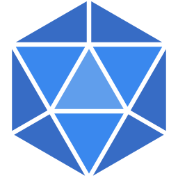

<p align="center">
  
</p>

<h1 align="center">Polykrom</h1>

<p align="center">
  <strong>An open-source parametric 3D CAD application built in pure Rust.</strong><br />
  Sketch, constrain, and build solids with a parametric feature timeline. Change a dimension
  and watch your model rebuild. Run it on your desktop, in your browser, or let AI agents
  model through the built-in MCP server.
</p>

<p align="center">
  Polykrom is a fork of <a href="https://github.com/tangency-labs/solidcraft">SolidCraft</a>, aimed at
  engineering for the physical world: parts you can analyse, assemblies you can test, and an AI
  companion that works through the same commands you do.
</p>


*A Raspberry Pi 4 case from an empty design: a sketch dimensioned with the board's parameters, extrude, fillet, shell, the rim rounded in one pick, an M2.5 standoff patterned on the 58 × 49 mm hole rectangle, port cut-outs, vent slots, "Pi 4" engraved in DejaVu Sans Bold and a PETG material defined in the design, with its mass in Properties, then height 24 → 32 mm in Parameters and it all rebuilds. 9× playback. [Full video](https://github.com/tangency-labs/solidcraft/raw/refs/heads/main/docs/screenshots/demo-0.8.mp4), recorded with the [demo script](examples/demo/record_ui.sh).*

## Where it comes from

Polykrom starts from SolidCraft, the open-source pure-Rust CAD application by the SolidCraft
contributors (MIT OR Apache-2.0), and keeps its history. Everything SolidCraft does, Polykrom
does; fixes that help both go upstream as pull requests to
[tangency-labs/solidcraft](https://github.com/tangency-labs/solidcraft) first. Polykrom adds:

- **Static stress analysis** (`analysis.static_stress`, Assembly › Static Stress): stress,
  deflection, reactions and the safety factor against yield, solved by
  [Nightfall](https://github.com/wckdboy/nightfall)'s verified study runner in a separate
  program ([docs/analysis.md](docs/analysis.md)).
- **Kernel robustness**: trimmed faces whose boundary crosses itself mesh instead of crashing,
  and moved bodies keep their edges on STEP export.

There are no Polykrom release builds yet; build it from source below. Inside, the crates,
binaries, design files and settings still carry SolidCraft's names; `polykrom` and
`polykrom-cli` are aliases ([docs/compatibility.md](docs/compatibility.md)).

## What works

Early but usable for simple parts: 75 of 76 public reference parts match their analytic or
FreeCAD-computed volume, area, centre of mass and bounding box ([oracle](docs/oracle.md)); the
other is a tracked bug.

- **Sketches and constraints:** lines, arcs, splines, text and more, solved by our own constraint solver, with parameter-driven dimensions.
- **Features:** extrude, revolve, sweep, loft, fillet, chamfer, shell, draft, holes, threads, patterns, mirror, split and combine on an editable parametric timeline.
- **Parameters and configurations** with unit-aware expressions.
- **Assemblies** with joints, motion studies, contact sets, interference and mass properties.
- **Sheet metal** with flanges, hems, fold/unfold and flat patterns, and plastic enclosure features.
- **Files:** STEP, IGES, 3MF, STL, OBJ and glTF in and out where supported, URDF export, `.solidcraft` designs.
- **Desktop app, browser app, headless CLI and MCP server**, all running the same commands.

The full list is in [docs/capabilities.md](docs/capabilities.md) and [docs/features.md](docs/features.md);
status and plans are in [ROADMAP.md](ROADMAP.md). See also [what people built](docs/showcase.md),
[3D mouse support](docs/3d-mouse.md) and the [architecture](docs/architecture.md).

## Build from source

```sh
cargo run --release -p solidcraft -- --sample      # desktop app with a sample part
cargo run --release -p solidcraft-cli -- commands  # the command registry (also: polykrom-cli)
cargo run --release -p solidcraft-cli -- run examples/bracket.json --out bracket.step
cargo xtask ci                                     # fmt, clippy, tests, icons, assets, layers, wasm
```

More commands, the Windows cross-build and the browser build are in [docs/building.md](docs/building.md).

## AI agents (MCP)

`solidcraft-cli mcp` is a [Model Context Protocol](https://modelcontextprotocol.io) server. Headless it
runs its own design session, or with `--connect` it drives the running app so you can watch.
Claude Code: `claude mcp add solidcraft -- solidcraft-cli mcp`. Tools, access rules and an
example session: [docs/mcp.md](docs/mcp.md).

## Scripts

A script is a JSON list of the same commands the UI runs, executed with `solidcraft-cli run`.
Format and example: [docs/scripts.md](docs/scripts.md). Pages can also be driven through the
[browser command API](docs/browser-api.md).

## Contributing

Help is welcome. [CONTRIBUTING.md](CONTRIBUTING.md) covers how to build and test, the code map,
the clean-room and licence rules, and where help is wanted most. Open work is in
[GitHub issues](https://github.com/wckdboy/polykrom/issues). Fixes that also apply to SolidCraft
are welcome upstream.

## Licence

MIT OR Apache-2.0, at your option, like SolidCraft. Developed under the
[clean-room contribution rules](AGENTS.md); third-party code and assets retain their
documented licences and attribution.

Polykrom is independent, and is not affiliated with or endorsed by the SolidCraft project. Behaviour is designed from public documentation, general CAD
conventions and user feedback. Reference tests use analytic values and open-source tools.
Polykrom is not affiliated with, sponsored by or endorsed by Autodesk, Dassault Systèmes, PTC,
Siemens or any other CAD vendor. Fusion, AutoCAD, Inventor, SolidWorks, Onshape, Creo, Blender and
Tinkercad are trademarks of their respective owners, named only to describe compatibility
(see [NOTICE](NOTICE)).
